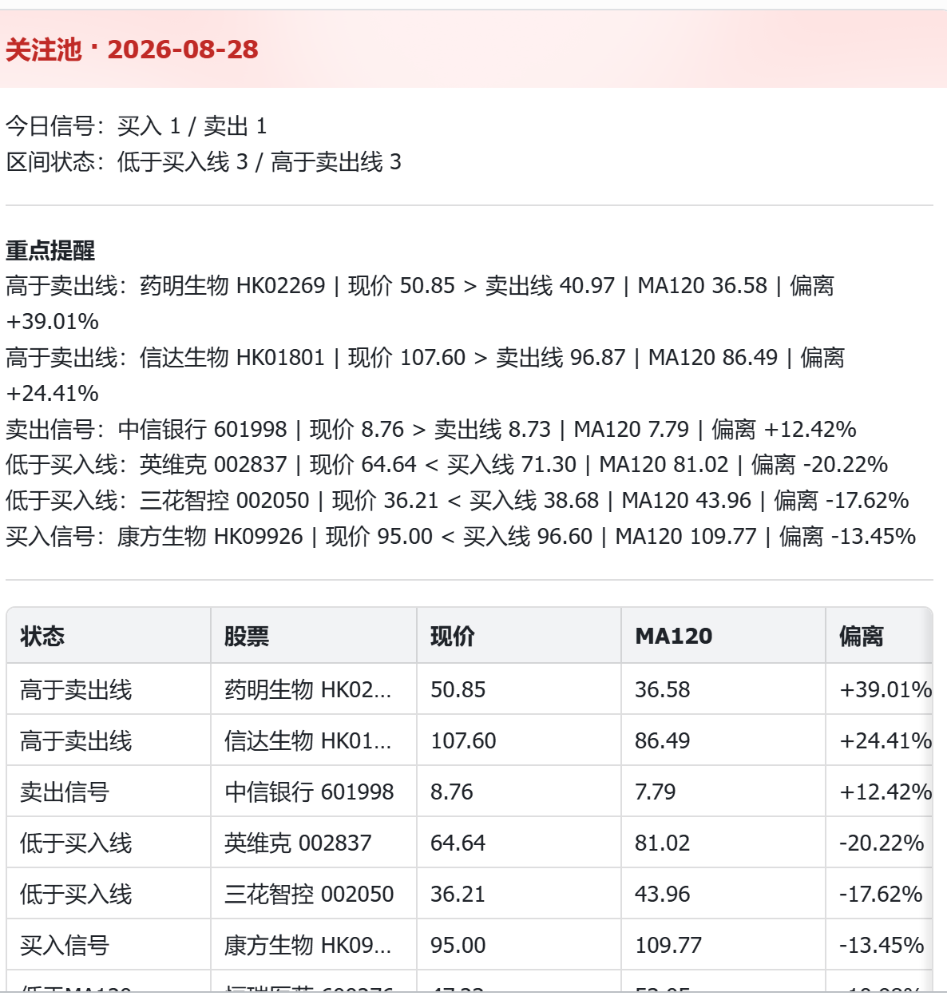

# ma120-monitor

基于 **MA120 均线** 的持仓 & 关注池监控脚本，每日通过飞书推送买入/卖出信号；另提供 ETF 均线、估值和涨跌幅三种定投计划。

## 效果示例

飞书卡片推送效果示例：



## 策略

- **MA120：** 最近 120 个交易日收盘价的算术平均值，即 `sum(最近 120 个交易日收盘价) / 120`；不足 120 根日 K 的股票会跳过。
- **偏离率：** `(现价 - MA120) / MA120 × 100%`，**基准是 MA120**，展示为「偏离MA120」列。
- **买入线：** `MA120 × 0.88`，即低于 MA120 约 12%。
- **卖出线：** `MA120 × 1.12`，即高于 MA120 约 12%。
- **距买入线：** `(现价 - 买入线) / 买入线 × 100%`，**基准是买入线**，展示为「距买入线」列。

> **两个偏离口径别看混了。** 买入线本身就是 `MA120 × 0.88` 派生出来的，所以现价在买入线下方时，它到 MA120 的距离**必然**比到买入线的距离大得多 —— 差的那部分正是 MA120×12% 的带宽。
> 例：现价 66.23、MA120 79.92、买入线 70.33 → 偏离MA120 **-17.12%**（差 13.69 元），距买入线 **-5.83%**（差 4.10 元）。两个都对，只是基准不同。

### 行情口径

- **A 股：** 新浪财经日 K 和实时盘口行情。
- **港股：** 腾讯前复权日 K 和实时盘口行情，股票代码使用 `HK` 加 5 位数字，例如 `HK01801`。
- **现价：** 使用实时盘口最新成交价，用于计算当前偏离率和判断信号。
- **MA120：** 只根据日 K 收盘价序列计算，实时价不会直接替换均线序列中的收盘价。
- **持久化：** 股票和 ETF 日 K、报价保存在本地 SQLite 数据库 `data/market.sqlite3`，不会因跨天失效而删除；`.stock_cache/` 只作为旧文件迁移来源。
- **回退：** 接口异常时保留并读取数据库里已有的历史数据，页面显示实际行情日期，旧数据不生成新的买入或今日穿越信号。
- **交易日判断：** 带上 `--skip-non-trading-day` 时，会先用几支大盘股（600015/601318/000651）探测当日实时行情；取不到就判定为非交易日并跳过推送，避免法定节假日调休时空推卡片。该判断**只在 09:30 之后可靠**——开盘前取不到实时价，无法区分「还没开盘」和「非交易日」。

### 信号判定

- **买入信号：** 当前价跌破当前买入线，并且上一交易日收盘价仍在上一交易日买入线之上或等于买入线。
- **卖出信号：** 当前价突破当前卖出线，并且上一交易日收盘价仍在上一交易日卖出线之下或等于卖出线。
- **区间状态：** 如果股票已经连续处于阈值之外，不会每天重复生成新的买入或卖出信号，而是显示为“低于买入线”或“高于卖出线”。

因此，“今日买入/卖出信号”表示当天首次穿越阈值；“低于买入线/高于卖出线”表示当前所处区间，两者含义不同。

## 文件结构

```
ma120-monitor/
├── stock_dynamic_monitor.py     # 主脚本（持仓 + 关注池，飞书推送）
├── stock_monitor.py             # 旧版（保留备查）
├── stock_portfolio_monitor.py   # 旧版（保留备查）
├── backtest_ma120_strategy.py   # MA120 策略回测工具
├── config_store.py              # SQLite 配置、事务与一次性迁移
├── doc/configuration-schema.sql # 配置表结构（初始化使用同一份 DDL）
├── stocks.xlsx                  # 旧数据，仅用于一次性迁移
├── pyproject.toml               # 项目元数据与依赖清单
├── uv.lock                      # 依赖锁定文件
├── conftest.py                  # pytest 路径配置
├── tests/                       # 单元测试（飞书卡片 / 行情数据）
├── .env.example                 # 飞书 webhook 配置模板
├── .github/workflows/           # GitHub Actions 定时任务
├── doc/images/                  # README 示例图片
├── LICENSE                      # MIT
├── data/market.sqlite3          # 持久化行情数据库（本地，不入 Git）
└── .stock_cache/                # 旧行情缓存（保留，用于迁移）
```

## 用法

### 数据保存与共享

**当前默认是本地独立数据库，不会通过 GitHub 自动共享或同步。** 每份项目目录使用自己的 `data/market.sqlite3`，保存该目录下的关注池、持仓、ETF 计划、策略规则与行情。重复启动会继续读取原数据库；不同电脑或不同项目目录的数据各自独立。同一目录启动的服务使用同一份数据库，当前没有按登录用户区分个人数据。

- GitHub 同步代码、SQL 表结构和默认种子；个人数据库、备份、成交账本和 `.env.local` 都不入 Git。
- 其他人克隆项目后会创建自己的 SQLite，导入仓库默认关注池与 ETF 示例；不会自动获得你的本机持仓、最新个人配置或历史行情。
- 在一台电脑上新增股票、修改计划或刷新行情，不会同步到另一台电脑。`git pull` 更新代码也不会覆盖或合并本地数据库。
- 换电脑并希望保留自己的数据时，需迁移 SQLite 的一致备份，以及另行保留的 `dca_results/journal.sqlite3` 成交账本；不是只克隆代码。

多人访问同一个服务器应用可以使用服务器上的同一份数据库，但**当前版本尚未提供共享部署模式**：服务只允许本机访问，也没有登录与用户权限管理。共享使用需要另行实现服务器部署、远程访问及权限控制。

### 其他人首次运行

安装 Git 和 uv 后，在终端执行：

```bash
git clone https://github.com/fanyohom/ma120-monitor.git
cd ma120-monitor
uv run python scripts/migrate_configuration.py
uv run python web_app.py
```

首次 `uv run` 会自动准备 Python 3.12 和依赖，迁移命令创建本机数据库并导入初始配置。打开 [配置管理](http://127.0.0.1:8765/configuration) 调整自己的关注池、持仓和计划，再在 [ETF 工作台](http://127.0.0.1:8765/) 或 [股票监控](http://127.0.0.1:8765/ma120) 点击刷新获取行情；没有历史数据时需要先刷新。数据库不需要另外安装 MySQL。

飞书推送是可选项，只使用网页时无需创建 `.env.local`；需要推送时再按下方步骤配置自己的 webhook。

### 安装 uv

本项目使用 `uv` 管理 Python、虚拟环境和依赖。首次使用先安装 `uv`：

```powershell
# Windows（推荐）
winget install --id=astral-sh.uv -e
```

macOS / Linux：

```bash
curl -LsSf https://astral.sh/uv/install.sh | sh
```

安装后运行 `uv --version` 确认命令可用。项目通过 `pyproject.toml` 声明依赖，并用 `uv.lock` 锁定版本；首次执行 `uv run` 时会自动准备 Python 3.12 和项目环境。

### 飞书推送配置（可选）

项目提供了 `.env.example` 模板。先复制一份为 `.env.local`：

```powershell
Copy-Item .env.example .env.local
```

然后编辑 `.env.local`，把占位 token 替换成飞书群机器人 webhook：

```env
FEISHU_WEBHOOK_URL=https://open.feishu.cn/open-apis/bot/v2/hook/你的-webhook-token
```

`.env.local` 已被 `.gitignore` 忽略，不要提交真实 webhook。

### Windows PowerShell

```powershell
cd D:\Project\github\ma120-monitor
$env:PYTHONUTF8='1'
$env:UV_CACHE_DIR='D:\Project\github\ma120-monitor\.uv-cache'

# 持仓 + 关注池（默认推送飞书卡片）
uv run python stock_dynamic_monitor.py

# 只看终端，不发飞书
uv run python stock_dynamic_monitor.py --no-feishu

# 非 A 股交易日直接跳过，不推卡片（定时任务的推荐用法）
uv run python stock_dynamic_monitor.py --skip-non-trading-day

# 只看持仓
uv run python stock_dynamic_monitor.py --portfolio --no-feishu

# 只看关注池
uv run python stock_dynamic_monitor.py --watchlist --no-feishu

# 运行测试
uv run python -m unittest discover -s tests

# 运行近 5 年历史回测
uv run --extra backtest python backtest_ma120_strategy.py
```

### macOS / Linux

```bash
cd /path/to/ma120-monitor
export PYTHONUTF8=1
export UV_CACHE_DIR="$PWD/.uv-cache"

# 持仓 + 关注池（默认推送飞书卡片）
uv run python stock_dynamic_monitor.py

# 只看终端，不发飞书
uv run python stock_dynamic_monitor.py --no-feishu
```

## 配置

所有关注与投资配置统一保存在 **`data/market.sqlite3`**：股票关注池、当前持仓、ETF 计划、投入周期、预算、金额阶梯与估值规则。MA120 Web、命令行监控、ETF 策略及回测工具读取同一份数据库配置。

```bash
uv run python scripts/migrate_configuration.py
```

打开 [配置管理](http://127.0.0.1:8765/configuration) 即可在页面新增、编辑或移出关注股票与持仓，维护 ETF 生效策略、预算及周期，并修改全局策略规则。成本和份额为非负数；股票成本或份额为 0 时只监控信号，不计算浮盈。

迁移优先读取已有 `watchlist.json/portfolio.json/etf_plans.toml`，股票 JSON 缺失时才尝试旧 Excel，ETF 个人文件缺失时使用模板种子。只导入一次，不修改原文件；此后修改旧文件不会覆盖数据库。主动清空关注池后也不会重新导入旧清单。持仓与关注池有相同代码时，页面优先显示持仓。

表结构、约束和接口说明见 [数据库设计](doc/database-design.md)，可直接查看 [配置 DDL](doc/configuration-schema.sql)。每次配置修改会在同一事务中更新版本并保存配置快照；停用 ETF 不会删除其历史成交。飞书 webhook 仍使用 `.env.local` 或环境变量。

港股代码请使用 `HK` 加 5 位数字，例如信达生物写作 `HK01801`，以保留前导零并自动切换港股行情源。

**依赖：** `uv run` 会根据 `pyproject.toml` 和 `uv.lock` 自动准备固定版本的 Python 与项目依赖，无需手动执行 `pip install`。回测依赖按需通过 `--extra backtest` 安装，旧版脚本依赖按需通过 `--extra legacy` 安装，不影响主监控的首次启动速度。

**飞书推送配置优先级：**

1. 环境变量 `FEISHU_WEBHOOK_URL`
2. 项目根目录 `.env.local` 中的 `FEISHU_WEBHOOK_URL`
3. 都没配置时，脚本会跳过飞书推送并在终端提示

## 行情数据库

项目使用本地 SQLite，无需安装或配置 MySQL。默认文件是 **`data/market.sqlite3`**，同时保存行情与个人配置；现有 `dca_results/journal.sqlite3` 成交及运行账本继续保留。

首次升级可把已有文件迁移入库：

```powershell
uv run python scripts/migrate_market_data.py
```

迁移会导入 `.stock_cache/sina_*.json`、`.stock_cache/etf/日期/*.json` 和 `etf_valuations/*.csv`，保留所有原文件。可重复执行，相同历史版本不重复入库。损坏或复权日期不一致的文件会列在 `skipped` 中；数据库不会用无效数据替换已有版本。

数据读取规则：

- 打开股票/ETF 页面，以及查看历史详情和历史测算，读取数据库；点击“刷新数据/刷新行情”才会重拉日 K 并保存。**MA120 页面的实时报价例外**：冷启动（含重启后）与快照满 5 分钟后，会在后台自动补一轮实时报价，页面先出数据库内容再自动更新，不需要手动刷新。
- 命令行监控仍按需要更新行情：股票同日可复用数据，ETF 同日 5 分钟内可复用。刷新失败会读取数据库已有记录，不清空数据；未曾保存过的品种仍显示数据待补。
- 前复权与未复权行情按**完整版本**保存，不把不同批次的复权价格拼接在一起。短历史刷新不会删除已保存的长历史；历史详情可选择数据库中有足够长度的版本，显示实际日期。
- 报价日期、均线截止日期、数据来源与获取时间一起保存。历史数据仍可显示均线和价格，但标记为“数据库历史行情”并暂停新买入提示。旧报价不是实时价。
- PE CSV 是导入入口；有效估值历史入库后，即使移走 CSV，也能按原 `valuation_csv` 与 `index_code` 从数据库读取。口径、公布日期、最小样本和新鲜度检查仍有效。没有获取或导入过的指数 PE 不会凭空出现。
- MA120 页面不再仅依赖服务内存：重启服务后可以直接使用数据库中的日 K、报价和已保存的测算快照。

主要数据表为 `history_versions`（行情版本与来源）、`daily_bars`（按版本保存的日 K）、`quotes`（报价）、`valuation_versions/index_valuations`（指数估值）、`dashboard_snapshots`（MA120 测算快照）。数据库采用 SQLite WAL，支持 Web 刷新与页面读取并行。

**`data/` 已排除 Git，是需要保留的本地数据，不是可随意清理的缓存。** 若删除数据库与旧缓存，就需要重新获取行情。建议定期备份：

```powershell
# 服务运行期间也可用；通过 SQLite backup API 保存一致的备份
uv run python scripts/backup_market_data.py

# 指定备份位置（目标不能是已有文件）
uv run python scripts/backup_market_data.py --output data/backups/my-market.sqlite3
```

默认备份放在 `data/backups/`，包含行情和个人配置。恢复时先停止本地服务，再用备份替换数据库；不要在服务运行中仅复制主 `.sqlite3` 文件而忽略 WAL。ETF 成交账本 `dca_results/journal.sqlite3` 需另外保留。

### 换机器还原关注池与「特殊关注」

因为 `data/` 不进 Git，新机器 clone 后**功能都在、数据都不在**：
关注池会从 `stocks.xlsx` 重新播种，但「特殊关注」星标和备注属于数据库里的数据，
不会跟着代码走 —— 看起来就像这个功能不存在。

为此提供了关注池快照，把清单与星标一起放进仓库：

```powershell
# 导出（本机有数据时执行，改完关注池或星标后重新导一次）
uv run python scripts/export_watchlist.py
# 生成 / 更新 watchlist.snapshot.json，随代码一起提交

# 导入（新机器 / 重装后）
uv run python scripts/import_watchlist.py            # 只把星标与备注合并到已有标的
uv run python scripts/import_watchlist.py --replace  # 连清单一起覆盖（会新增/删除条目）
```

默认是**合并**而不是覆盖：快照可能比本地库旧，直接覆盖会无声删掉你在本机新加的标的，
所以危险动作必须显式加 `--replace`。

## ETF 定投

### 本地 Web 工作台

启动 ETF 数据页面：

```bash
uv run python web_app.py
```

浏览器打开 `http://127.0.0.1:8765/`。页面显示四只 ETF 的生效策略、当期预算、数据状态、三策略对比，以及正式计划的运行记录和成交账本。点击顶部「示例计划」或「本地计划」可查看当前配置的周期与预算；该按钮只展示信息，不会启用或修改计划。「刷新数据」会跳过 5 分钟短缓存、重新请求报价；沪深 300 的估值策略生效时还会更新其指数 PE 历史，再计算建议。更新估值失败会保留旧 CSV 并显示提醒，是否仍可使用由数据新鲜度规则决定。只有生效策略在有效行情和计划周期内产生可买整手的预算时，Web 才显示买入条件提示；示例计划的提示仅供观察，不是个人交易计划。Web 不提供成交录入或下单，真实成交仍可通过下文命令行账本登记，以维护成本和防重复状态。Web 服务默认只监听本机，不需要登录。

总览页在计划列表前说明三种已实现的定投方式：均线按价格偏离调整预算；涨跌幅按个人持仓平均成本的浮盈亏调整预算，**不是单日涨跌或高点回撤**；估值按跟踪指数 PE-TTM 历史分位决定投入或暂停。每只 ETF 仅选中的一种策略计入本期预算，其他方法只供对比；普通固定金额定投尚无独立选项。

顶部导航还可进入 `http://127.0.0.1:8765/ma120`：独立的 MA120 股票页从 `portfolio.json` 读取持仓、从 `watchlist.json` 读取关注池，展示 MA120、买卖线、今日穿越信号、区间状态与已填写成本的持仓浮盈亏。页面可手动增删改关注池；支持搜索、状态筛选，以及信号优先、买入优先、卖出优先或代码顺序排序；清单默认每页 10 只，可切换为 20 或 50 只。点击股票进入独立详情页，可查看已完成日 K 的价格、MA120、买卖阈值和按当前监控规则回放的模拟 B/S 点及事件日期。历史 B/S 仅表示收盘价首次穿越当日阈值的参考信号，两个方向独立记录，因此 S 可能早于 B；它不是实际成交，也不能假定按触发信号的同日收盘价成交。详情页另可选起算日，用 10 万元该股票交易币种的虚拟资金从零仓位开始，空仓遇 B 买入、持仓遇 S 卖出，并以**下一根已完成日 K 的收盘价**模拟成交；期末未卖出的持仓按最新收盘价估值。测算不读取真实持仓，允许零碎股数，未计手续费、滑点、整手限制或现金分红，不代表可执行收益。刷新只读取行情，不发送飞书或下单。休市时使用最近收盘价展示区间状态，不把旧穿越误报为今日信号。港股与 A 股持仓按币种分别汇总。

点击计划可进入独立详情地址（例如 `/etf/csi300`），查看策略对比、历史价格和 B/S 点。图表默认显示最近约 240 根已完成日 K，可切换 3 年或全部，并用前后按钮、日期滑块查看更早区间；行情按每页最多 800 根向前读取，最多请求 5000 根，实际最早日期取决于 ETF 上市及数据源覆盖。均线、估值和涨跌幅三种生效策略都可从各自有足够数据的历史日期选择起算，从**零模拟持仓**逐期生成参考 B 点并估算累计投入、期末价值和收益率，不读取个人持仓或真实成交。早期价格即使可见，MA500 预热或指数 PE 十年样本不足时也不会生成模拟买点。沪深300估值回放在每个历史决策日只使用此前已经可获得的指数 PE；纳指涨跌幅回放则用模拟买入不断更新自己的虚拟平均成本。非 MA 策略中的 MA500 只作价格对照。真实成交 B/S 点若存在，仍单独按账本显示。回放按当日收盘价判断并假设同价整手买入，实际无法保证同价成交，可能高估可执行收益；不模拟卖出、手续费、滑点或税费，也不是未来收益预测。

四只示例 ETF 的详情页还包含“产品与指数”档案：基金全称、管理人、跟踪指数、投资范围与官方基金/指数资料链接。档案按 ETF 交易代码匹配；自定义的其他 ETF 没有对应档案时不会套用示例产品信息。跨境 ETF 的说明区分标的指数、基金净值和人民币场内价格。

计划详情的历史图显示深色前复权价格线、同一价格尺度上的虚线均线、按当前生效策略重算的模拟 B 点，以及成交账本中的真实 B/S 点。悬浮或点击图表可查看就近交易日的前复权与未复权收盘价、MA、偏离率、日涨跌和当日事件；估值策略还显示当时可用的 PE 与分位。聚焦图表后也可用左右方向键逐日查看。两条图线统一换算到最新收盘价尺度，避免分红或拆分导致未复权价格与前复权均线混画；每个历史日的 MA 只使用此前 N 根已完成日 K，不含当日，整手预算和事件表价格仍使用当日未复权收盘价。模拟 B 按周期只显示一次可买整手的日期，是规则回放，不代表实际下单。当前 ETF 策略没有定义自动卖出规则，因此模拟 S 不生成；S 只来自已登记的真实卖出。事件列表保留完整回溯区间，图表只显示当前选中的时间窗口；超出行情覆盖范围的实际成交会标明。

首次没有个人计划时，数据库会导入模板作为示例种子；在配置管理页保存个人计划后启用运行留档。模板和旧 `etf_plans.toml` 不再作为日常配置来源。没有导入过对应 PE 历史时，估值策略仍显示数据待补。

股票 MA120 和 ETF 定投是两个独立入口。ETF 模块只生成计划、保存结果和登记你已经成交的交易，**不连接券商、不自动下单**。ETF 清单不放在 `stocks.xlsx`，避免与股票信号混在一起。

投资方法背景见 [指数基金定投策略指南](doc/index-fund-investment-guide.md)：包含普通定投、涨跌幅定投、均线定投、估值定投、作者的退出思路，以及与当前实现的差异。

### 启动与清单

首次迁移配置后，在项目目录执行：

```powershell
uv run python scripts/migrate_configuration.py

# 只看四只 ETF 的生效策略，不推送
uv run python etf_dca.py

# 同时比较三种策略，共 12 行，不推送
uv run python etf_dca.py --compare

# 用同一个 .env.local webhook 推送 ETF 原生表格卡片
uv run python etf_dca.py --compare --feishu

# 也可从原主脚本进入；该入口延续默认推送的习惯
uv run python stock_dynamic_monitor.py --etf --compare --no-feishu
```

Windows/macOS/Linux 使用同一套命令。通过配置管理页编辑数据库中的计划，模板种子提供以下四只境内上市 ETF，单位均为人民币：

| 计划 ID | ETF | 代码 | 跟踪指数标识 |
| --- | --- | --- | --- |
| csi300 | 华泰柏瑞沪深300ETF | 510300 | 000300 |
| csi1000 | 南方中证1000ETF | 512100 | 000852 |
| sp500 | 博时标普500ETF | 513500 | SPX |
| nasdaq100 | 国泰纳斯达克100ETF | 513100 | NDX |

标识 `SPX`、`NDX` 用于本项目估值文件匹配，不是境内 ETF 的交易代码。产品信息可查[南方基金](https://www.nffund.com/main/files/2024/10/25/381785095382.pdf)、[博时基金](https://www.bosera.com/column/index.do?classid=0002000200030004&fundCode=513500)、[国泰基金](https://www.gtfund.com/product/productlist/haiwai/513100/index.html)。

模板默认每只 `base_amount = 1000`、单期 `max_amount = 2000`，每周一。四只 ETF 分别设置了示例生效策略，页面会展示各自的选用原因；**它们不是经过收益与回撤对比验证的最优参数或投资建议**。

| ETF | 示例生效策略 | 选用原因与前提 |
| --- | --- | --- |
| 沪深300 · 510300 | 估值定投 | 已有沪深300指数的长期 PE-TTM 历史，可按自身分位决定是否新增投入。 |
| 中证1000 · 512100 | MA500 均线定投 | 尚未补齐 000852 的同口径长期 PE 历史，先用价格偏离调节预算；均线不代表估值。 |
| 标普500 · 513500 | MA500 均线定投 | 尚无可靠的 SPX 长期估值文件，暂用人民币场内 ETF 价格观察趋势；汇率、交易时差与折溢价都会影响该价格。 |
| 纳斯达克100 · 513100 | 涨跌幅定投（试行） | 按**个人持仓均价**的浮盈亏调节预算；示例尚无持仓，故每期只按首期基础金额，登记真实成交后才会动态调整。 |

视频作者更倾向对美股指数使用普通固定金额定投；本项目尚无独立普通定投策略，纳指的涨跌幅只是对当前实现的试行选择，不能推导为比普通定投或 MA500 收益更好。切换为涨跌幅后，纳指详情页不会再显示只适用于 MA 规则的历史参考 B 点或收益回放。跨境 ETF 场内价格可能偏离参考净值，参见上交所的 [513100](https://www.sse.com.cn/disclosure/fund/announcement/c/new/2026-01-09/513100_20260109_EPLN.pdf) 与 [513500](https://www.sse.com.cn/disclosure/fund/announcement/c/new/2026-06-26/513500_20260626_MAHV.pdf) 风险公告。本版没有折溢价过滤。每只 ETF 的 `strategy` 只能选择一种：

- `ma`：均线定投。
- `valuation`：指数估值定投。
- `drawdown`：相对实际持仓成本的涨跌幅定投，**不是相对历史最高价的回撤**。

`--compare` 中其余两种策略只显示参考预算，本期预算为 0，不会重复加总。`cost` 和 `shares` 是使用账本前的初始持仓；默认均为 0，表示无持仓。

### 三种计算规则

均线定投的均线周期在配置管理页设置，支持 120、180、250、500 等，当前上限 600。公式为 `最近 N 个已完成交易日的前复权收盘价之和 / N`，**始终排除运行当天的日 K**，避免盘中未收盘的 K 线改变均线。偏离为 `(实时价 / 均线 - 1) * 100%`。

涨跌幅定投使用 `(实时价 / 持仓平均成本 - 1) * 100%`。尚无持仓时，首期按基础金额；有持仓时必须有有效成本。买入成交金额和佣金计入平均成本，卖出按比例减少持仓成本总额。

这两种策略默认共用以下阶梯，均可在 `bands` 和 `above_multiplier` 中修改。`below` 是**严格小于**的上界：

| 相对均线或成本的偏离 | 基础金额乘数 |
| --- | --- |
| 小于 -20% | 2.0 |
| -20% 至小于 -10% | 1.5 |
| -10% 至小于 0% | 1.2 |
| 0% 至小于 10% | 1.0 |
| 10% 至小于 20% | 0.8 |
| 大于等于 20% | 0.5 |

预算为 `min(基础金额 * 乘数, 单期上限)`。按行情价格向下取 100 份的整手，显示本期预算、份额和整手估算金额；估算不含佣金，未用满的预算不会自动滚入下一期。

估值定投看的是**跟踪指数的 PE-TTM 历史分位**，不拿 ETF 价格、均线或基金净值充当估值：

- 小于 30% 分位：按基础金额定投，仍受单期上限约束。
- 30% 至小于 70% 分位：暂停新增投入。
- 大于等于 70% 分位：暂停并标注“高估，减仓观察”。本版不自动生成分批卖出数量。

分位采用中间秩：`(小于当前 PE 的样本数 + 等于当前 PE 的样本数 / 2) / 样本总数 * 100%`。连续相同 PE 的历史是 50% 分位，不会被当成 100%。30% 分位并不是 PE 小于 30 倍。

### 估值数据导入

沪深 300 的 PE-TTM 可从[中证指数历史接口](https://www.csindex.com.cn/csindex-home/perf/index-perf?indexCode=000300&startDate=20120904&endDate=20260930)导入。官网页面将接口的 `peg` 字段标为“滚动市盈率 / PETTM”；运行下面的命令会校验当前十年窗口的数据覆盖和最新日期，并保存从 2012-09-04 起连续有值的官方估值历史到本地 `etf_valuations/000300.csv`，供更早的逐日分位回放使用。此前官网滚动 PE 大量为空，不会补造：

```bash
python scripts/update_csi300_valuation.py
```

接口没有提供逐日发布时间，因此导入器**假定每条估值在交易日次日可用**，写入 `available_date`；这只是避免同日回看偏差的项目假设，不能证明真实发布时间。CSV 是本地数据文件，已被 `.gitignore` 排除；Web 刷新沪深 300 估值生效计划时会自动更新，也可用上面的命令手动更新。其他指数尚未接入自动数据源，可从可靠平台导出相同计算口径的指数 PE-TTM 历史 CSV；模板 `etf_valuation.example.csv` 只含表头。对应文件路径在每只计划的 `valuation_csv` 中设置：

```text
etf_valuations/000300.csv
etf_valuations/000852.csv
etf_valuations/SPX.csv
etf_valuations/NDX.csv
```

每份 CSV 必须包含：

| 列 | 含义 |
| --- | --- |
| date | 估值所属日期，YYYY-MM-DD |
| available_date | 该数据实际可获得的日期，YYYY-MM-DD，不得早于 date |
| index_code | 与计划一致的指数标识；000300/000852 要保留前导零 |
| pe_ttm | 正数、有限值，统一 PE-TTM 计算口径 |

当前估值分位取截至运行前一天的近 10 年数据，至少 2000 个观测、跨度至少 3285 天，最新估值距离该截止日不超过 7 个自然日。沪深 300 CSV 保存从 2012-09-04 起连续可用的官方 PE，以便逐日回放较早时点；每个时点仍只用此前可获得的近十年窗口，早于有效窗口的价格仅供查看。配置项分别为 `lookback_years/min_samples/min_span_days/max_age_days`。日级公布日期无法表达盘中何时可用，因此保守地排除运行当天发布的估值，忽略未来或尚未公布的记录。重复日期、非正 PE、缺失、过期或样本不足会显示“数据待补”，该策略的本期预算为 0。不能把一年数据算出的分位标成十年分位。跨境指数的 `available_date` 请按北京时间可获得信息的日期填写。

### 行情、周期与结果

- ETF 日 K 使用腾讯前复权和未复权序列，请求截止日固定为运行前一天，避免接口额外追加当日盘中 K 线导致数量或日期不一致；实时价格单独获取。以最新共同日的开盘价比例将复权序列换算到比较价格尺度，再与腾讯实时价比较。复权序列缺失时不会悄悄用未复权替代。
- ETF 均线基于**境内 ETF 的人民币场内价格**。标普/纳斯达克 ETF 的价格还受汇率和折溢价影响，不等于美国指数本身的均线；本版尚未加入 IOPV/溢价过滤。
- ETF 完整行情版本保存在 `data/market.sqlite3`，同日最多复用 5 分钟；旧 `.stock_cache/etf/日期/` 文件保留供迁移。取长均线时优先选择有足够长度的数据库版本。网络失败继续显示历史行情、实际日期和更新错误，不产生新买入提示。
- `frequency` 支持 `daily`、`weekly`、`monthly`；周计划 `weekday=0..4` 表示周一至周五，月计划 `monthday=1..28`。计划日非交易日时，同周/同月内顺延到有当日交易行情的运行日；不会补买更早周期遗漏的预算。运行脚本本身不会安装定时任务。
- 使用当日有效、有成交量的行情判断可生成计划，盘中还检查行情是否在 10 分钟内。休市、停牌或旧行情只展示参考，不产生本期买入预算。收盘后可用当日收盘盘口生成建议。
- 每次运行保存独立的 `dca_results/时间_运行ID.json` 和 `.txt`，并保存到 `journal.sqlite3` 的 reports 表。JSON 包含配置快照、行情时间、均线日期、估值样本区间、预算和原因。此处是运行建议的留档，**不是收益回测结果**。
- 运行预览或推送不代表成交；只在登记真实买入后才将该周期标为“本期已买入”。本地配置、估值 CSV、账本和结果都已加入 `.gitignore`，不要删除账本，否则会失去成本和防重复记录。
- 若生效策略缺数据，进程退出码为 2；配置、网络推送等运行错误为 1；正常预览为 0。对比策略缺失不会阻止其他生效策略。

### 成交登记

实际在券商成交后，用唯一成交编号登记，下面的价格、份额和日期都需要替换为你的真实成交：

```powershell
uv run python etf_dca.py --record-trade csi300 --side buy --shares 200 --price 4.20 --fee 5 --trade-date 2026-09-07 --fill-id broker-20260907-001

# 卖出同样登记，自动更新剩余份额；不能卖超已有持仓
uv run python etf_dca.py --record-trade csi300 --side sell --shares 100 --price 4.30 --fee 5 --trade-date 2026-09-08 --fill-id broker-20260908-001
```

登记命令不会请求行情、发送交易或推送飞书。相同 `fill-id` 不允许重复登记；同一计划按成交日期顺序录入。已有账本后，不要把登记过的交易再加进配置的初始 `cost/shares`，也不要把原计划 ID 改成另一只 ETF。分红、份额拆分和券商持仓自动同步尚未实现，发生这些情况后需先核对成本与份额。

## 定时运行

仓库已内置 GitHub Actions workflow：`.github/workflows/ma120-monitor.yml`，每天 **UTC 03:30**（北京时间 11:30，A 股上午收盘后）自动执行，无需本机常开。监控 job 依赖测试 job，指标算错时不会推送。

启用步骤：

1. 进入仓库 **Settings → Secrets and variables → Actions → New repository secret**
2. 名称填 `FEISHU_WEBHOOK_URL`，值填你的飞书群机器人 webhook
3. 打开 **Actions** 页签，选择 `MA120 Monitor` → **Run workflow** 手动触发一次验证

> 说明：
>
> - **实际到达时间约为北京时间 16:47，不是 11:30。** GitHub 的 schedule 不保证准点：实测 2026-10 的三次 Scheduled 运行分别在 UTC 08:47 / 08:47 / 09:03 触发，相对 03:30 的 cron **稳定延迟约 5 小时 20 分**。
> - **为什么不做 cron 补偿**：延迟虽然稳定，但一旦某天变短，触发就会落到 09:30 之前；而 `--skip-non-trading-day` 在盘前无法区分「还没开盘」和「非交易日」，会把当天判成非交易日并**静默跳过**。「晚到」比「漏跑」可接受，因此 cron 保持 03:30 不动。
> - **两条通道口径不同**：本机定时任务（11:35）是**盘中口径**（MA120 基于上一交易日收盘 + 当天上午实时价）；本通道在收盘后运行，数据源通常已更新当日日 K，MA120 可能已含当日收盘价，属于**收盘后口径**。两者信号不一致属正常，可互为复核。
> - 未配置 `FEISHU_WEBHOOK_URL` secret 时脚本不会报错，只在日志里提示跳过飞书推送。
> - 交易日过滤已开启：workflow 用 `--skip-non-trading-day`，周末与法定节假日探测不到当日行情即跳过，不会空推卡片。
> - `pull_request` 和 `push` 会触发 `test` job 跑单元测试，改动引入回归时会在合并前被拦住。

定时规则用「每天」而非「周一至周五」，因为 GitHub 的 cron 虽支持 `1-5`，但法定节假日无法表达。配合 `--skip-non-trading-day` 即可自动跳过非交易日。注意该判断**只在 09:30 之后可靠**，因此不要把同样的参数用在盘前任务上。

## 免责声明

本项目仅供学习与研究使用，不构成任何投资建议。股市有风险，投资需谨慎；据此操作，风险自担。行情数据来自第三方公开接口，不保证其准确性与实时性。

## License

[MIT](LICENSE)
