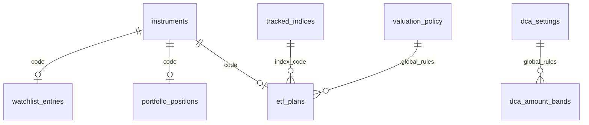

# 投资监控数据库设计

项目使用本地 SQLite：`data/market.sqlite3`。关注池、持仓、ETF 计划、策略规则和行情共用这一数据库。现有 ETF 成交与运行账本继续保存在 `dca_results/journal.sqlite3`，不重复搬动历史成交。

这里的“共用”指同一项目目录中的模块共用一个数据库，**不是不同电脑之间共享**。数据库按项目目录保存，未上传 GitHub，也没有跨设备同步；重新启动会读取原文件。同目录运行的实例会使用同一份数据，当前表结构没有登录用户或多租户隔离。

其他人克隆仓库后初始化的是自己的数据库和默认种子。若要迁移已有个人数据，需要一致备份及独立的成交账本；若要多人共享服务，需要另行实现服务器部署、远程访问和登录权限，当前本机服务不直接提供该模式。完整首次启动步骤见 [README](../README.md#其他人首次运行)。

完整配置 DDL 见 [configuration-schema.sql](configuration-schema.sql)，代码初始化时执行同一份 DDL。字段变更需同时考虑已存在的数据库，不应通过删库重建升级。

## 配置表与关系



图中 `code` 和 `index_code` 是物理外键；全局规则关系表示共享配置。金额阶梯和全局设置是单一规则组，不允许多个同名策略配置混用。

| 表 | 主键 / 唯一键 | 主要字段与用途 |
| --- | --- | --- |
| instruments | code | 证券代码、统一名称、stock/etf 类型、CNY/HKD 币种、创建及更新时间 |
| watchlist_entries | code，外键 | 股票关注记录、排序；移出关注不删除证券或行情 |
| portfolio_positions | code，外键 | 当前股票平均成本、份额、排序；移出持仓不影响关注池 |
| tracked_indices | index_code | 跟踪指数标识，保留 000300/000852 前导零，支持 SPX/NDX |
| etf_plans | id；code 唯一 | 证券、指数、生效策略、预算、周期、初始持仓、估值来源、启用状态、排序 |
| dca_settings | id=1 | ETF 均线周期、整手份额、超过全部阶梯后的金额倍数 |
| dca_amount_bands | sort_order；below 唯一 | 递增偏离上界与对应金额倍数 |
| valuation_policy | id=1 | PE 历史窗口、最低样本、跨度、新鲜度、低估及高估分位 |
| ma120_settings | id=1 | 股票均线周期、买卖线倍数、默认历史长度 |
| configuration_meta | key | 已初始化标记、当前配置版本、示例模式标记 |
| configuration_imports | source | 迁移来源、SHA256、迁移时间，便于核对原文件 |
| configuration_changes | 自增 id | 修改时间、操作、完整配置快照，保留历史版本 |

### 类型和约束

代码用 TEXT，不能用 INTEGER，否则会丢失前导零。同一证券在关注池、持仓、ETF 计划中引用同一条 `instruments`，名称修改会同步生效。港股代码使用 `HK` 加五位数字。

ETF 基础金额与单期上限用 INTEGER 保存人民币分，例如 123.45 元存为 12345；接口展示时换算为元。预算最多两位小数，禁止负数、非有限数字和超出 SQLite 整数范围的金额。行情价格和平均成本沿用 REAL，份额按业务区分：股票持仓允许非负小数，ETF 初始份额要求非负整数。

周计划仅允许周一至周五，月计划仅允许 1 至 28 日；每日计划不保存周/月日期。金额阶梯的上界必须唯一且递增。规则必须满足 `0 < buy_below < high_at <= 100`，股票买入线倍数小于 1，卖出线倍数大于 1。

ETF 计划 ID 和证券代码创建后不可更换，以防历史成交被挂到另一只 ETF。计划以 `enabled=0` 停用，不硬删除。停用后不生成预算，但原 ID、成交和运行记录保留；重新编辑可以启用。已有成交登记后禁止修改 ETF 初始成本或份额，避免双计持仓。

`valuation_source` 是估值系列的来源标识，为兼容既有导入流程，运行对象仍使用 `valuation_csv` 字段。它不意味着必须保留 CSV 文件：已导入的估值从数据库读取。新增计划默认使用跟踪指数对应的标识；旧计划迁移时保留原标识，避免与已有估值记录脱节。

## 事务与迁移

所有配置写入使用 `BEGIN IMMEDIATE`，在同一事务中完成校验、表更新、版本递增和配置快照。关注池的读—修改—写在事务内执行，避免同时添加不同股票时互相覆盖。连接均启用外键和 WAL。

执行一次性迁移：

```powershell
uv run python scripts/migrate_configuration.py
```

股票配置优先读取现有 `watchlist.json` 和 `portfolio.json`；若不存在，才读取旧 `stocks.xlsx` 相应 sheet。ETF 优先读取现有 `etf_plans.toml`，没有个人文件时将模板作为示例种子导入。原文件保留，不删除、不改写。

每个部分有独立初始化标记。迁移完成后，正常运行只读数据库；重复执行不会覆盖后续数据库修改。即使用户清空关注池或停用全部 ETF，也不会从旧文件自动恢复。首次导入任何部分校验失败时，整个事务回滚，避免留下部分配置。

旧 JSON/TOML 可继续作为显式迁移或诊断输入，但它们不再是日常配置源。ETF 命令行明确带 `--config 某文件.toml` 时才使用该覆盖文件；不带参数则读取数据库。

## 页面与接口

配置页：[本地配置管理](http://127.0.0.1:8765/configuration)。包括股票关注池、股票持仓、ETF 计划与策略规则四个表单区，保存后更新数据库，不联网取行情、不下单、不发送飞书。

| 接口 | 方法 | 用途 |
| --- | --- | --- |
| /api/configuration | GET | 配置版本、关注池、持仓、全部 ETF 计划及规则 |
| /api/ma120/watchlist | GET / POST | 读取或新增关注股票 |
| /api/ma120/watchlist?code=... | PATCH / DELETE | 改名或移出关注 |
| /api/configuration/portfolio | POST | 新增当前股票持仓 |
| /api/configuration/portfolio?code=... | PATCH / DELETE | 修改或移出持仓 |
| /api/configuration/plans | POST | 新建 ETF 计划 |
| /api/configuration/plans?id=... | PATCH / DELETE | 修改计划或停用 |
| /api/configuration/rules | POST | 原子保存 ETF、估值和股票规则 |

沿用服务的本机 Host、Origin 与 JSON 请求校验。无效字段、金额、重复证券或计划返回 400，不存在的记录返回 404，跨站写入返回 403。修改配置后，旧测算快照会失效，下一次读取按新配置从行情数据库重算；获取最新行情仍需点击刷新。

## 备份与数据范围

`data/market.sqlite3` 备份现在包含行情和全部个人配置：

```powershell
uv run python scripts/backup_market_data.py
```

`data/` 不入 Git。恢复数据库前先停止本地服务；需要恢复真实 ETF 成交时，还须保留 `dca_results/journal.sqlite3`。旧文件及数据库备份都应按个人数据保管。

迁移配置不会补出尚未获取的 PE 历史，也不改变策略收益含义。基金产品说明仍由资料目录提供，个人代码、名称、预算、持仓与策略选择以数据库为准。飞书 webhook 继续读取环境变量或 `.env.local`，不纳入关注配置表。
